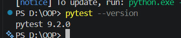
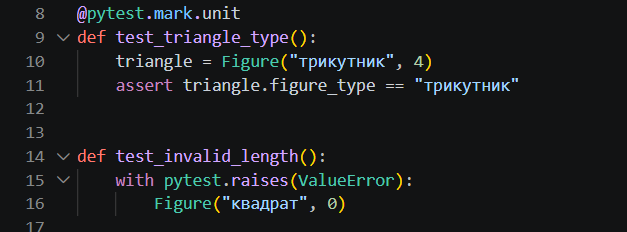
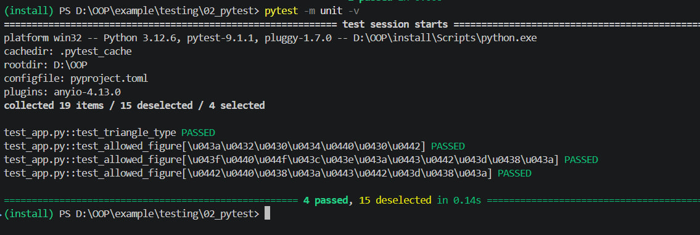
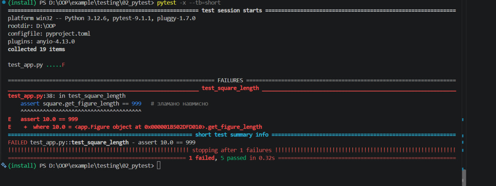
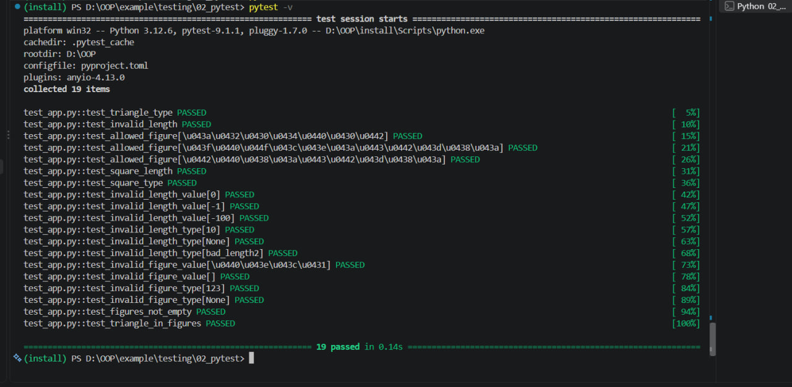

# Звіт до роботи
 
**Тема:** Тестування з бібліотекою pytest  
**Мета роботи:** Ознайомитися зі сторонньою бібліотекою `pytest`, навчитися писати тести у вигляді звичайних функцій, використовувати `assert` і `pytest.raises`, застосовувати параметризацію, fixtures та маркери.  
**Виконала:** Половко Аліна, КН-42
 
---
 
## Виконання роботи
 
### Завдання 1. Встановлення pytest
 
Активували віртуальне середовище з попередньої роботи та встановили бібліотеку як залежність для розробки.
 
**Команда встановлення:**
 
```bash
pip install pytest
# або, якщо проєкт на Poetry
poetry add --group dev pytest
```
 
**Перевірка встановлення:**
 
```bash
pytest --version
```
 
> **Скріншот встановлення pytest та результату `pytest --version`:**

---
 
### Завдання 2. Перші тести (`assert` та `pytest.raises`)
 
У папці `02_pytest` створили файл `test_app.py`. Функції, назва яких починається з `test_`, pytest розпізнає як тести автоматично. Для перевірки значень використали звичайний `assert`, а для перевірки винятків — `pytest.raises`.
 
```python
@pytest.mark.unit
def test_triangle_type():
    triangle = Figure("трикутник", 4)
    assert triangle.figure_type == "трикутник"
 
 
def test_invalid_length():
    with pytest.raises(ValueError):
        Figure("квадрат", 0)
```
 
> **Скріншот коду базових тестів:**

---
 
### Завдання 3. Параметризація та fixtures
 
Додали параметризований тест для всіх дозволених фігур, а також fixtures `length` і `square` (fixture `square` залежить від fixture `length`), які повертають квадрат із довжиною 10.
 
```python
FIGURES = ["квадрат", "прямокутник", "трикутник"]
 
 
@pytest.mark.unit
@pytest.mark.parametrize("figure", FIGURES)
def test_allowed_figure(figure):
    assert Figure(figure, 1).figure_type == figure
 
 
@pytest.fixture
def length():
    return 10
 
 
@pytest.fixture
def square(length):
    return Figure("квадрат", length)
 
 
def test_square_length(square):
    assert square.get_figure_length == 10
 
 
def test_square_type(square):
    assert square.figure_type == "квадрат"
```
 
 
---
 
### Завдання 4. Тести для неправильних типів і значень
 
Клас `Figure` викидає різні винятки залежно від причини помилки, тому для кожної ситуації написали окремий параметризований тест:
 
| Ситуація | Приклади даних | Виняток |
|---|---|---|
| Неправильне значення довжини | `0`, `-1`, `-100` | `ValueError` |
| Неправильний тип довжини | `"10"`, `None`, `[5]` | `TypeError` |
| Неправильне значення фігури | `"ромб"`, `""` | `ValueError` |
| Неправильний тип фігури | `123`, `None` | `AttributeError` |
 
```python
@pytest.mark.parametrize("bad_length", [0, -1, -100])
def test_invalid_length_value(bad_length):
    with pytest.raises(ValueError):
        Figure("квадрат", bad_length)
 
 
@pytest.mark.parametrize("bad_length", ["10", None, [5]])
def test_invalid_length_type(bad_length):
    with pytest.raises(TypeError):
        Figure("квадрат", bad_length)
 
 
@pytest.mark.parametrize("bad_figure", ["ромб", ""])
def test_invalid_figure_value(bad_figure):
    with pytest.raises(ValueError):
        Figure(bad_figure, 5)
 
 
@pytest.mark.parametrize("bad_figure", [123, None])
def test_invalid_figure_type(bad_figure):
    with pytest.raises(AttributeError):
        Figure(bad_figure, 5)
```
 
---
 
### Завдання 5. Fixture зі `scope="module"`
 
Створили fixture, яка створюється один раз для всього модуля та використовується у двох тестах.
 
```python
@pytest.fixture(scope="module")
def allowed_figures():
    return FIGURES
 
 
def test_figures_not_empty(allowed_figures):
    assert len(allowed_figures) > 0
 
 
def test_triangle_in_figures(allowed_figures):
    assert "трикутник" in allowed_figures
```

---
 
### Завдання 6. Маркери
 
Додали маркер `unit` до двох тестів (`test_triangle_type` і `test_allowed_figure`). Щоб pytest знав про власні маркери, зареєстрували їх у конфігураційному файлі:
 
```toml
[tool.pytest.ini_options]
markers = [
    "unit: швидкі юніт-тести",
    "slow: повільні тести"
]
```
 
Запуск лише тестів із маркером:
 
```bash
pytest -m unit -v
```
 
> **Скріншот налаштування маркерів та результату запуску `pytest -m unit -v`:**

---
 
### Завдання 7. Навмисно зламаний тест
 
У тесті `test_square_length` змінили очікуване значення з `10` на `999` і запустили pytest із параметрами `-x --tb=short`:
 
```python
def test_square_length(square):
    assert square.get_figure_length == 999   # зламано навмисно
```
 
```bash
pytest -x --tb=short
```
 
**Пояснення результату:**
 
* `-x` зупинив запуск одразу після першої помилки, тому тести, які йшли після `test_square_length`, не виконувались;
* `--tb=short` скоротив traceback: замість довгого виводу залишився рядок з `assert` та значення «отримано / очікувалось» (`10.0 == 999`);
* помилка виникла тому, що `get_figure_length` повертає `10.0`, а тест очікував `999`.
Після перевірки значення повернули на `10`.
 
> **Скріншот результату `pytest -x --tb=short`:**

 
---
 
## Результати виконання та пояснення
 
**Команди запуску тестів:**
 
* `pytest -v` — запуск усіх тестів у розширеному режимі;
* `pytest test_app.py::test_triangle_type -v` — запуск одного тесту;
* `pytest -m unit -v` — запуск тестів із маркером `unit`;
* `pytest --collect-only` — перегляд знайдених тестів без запуску;
* `pytest -x --tb=short` — зупинка після першої помилки зі скороченим traceback.
**Результат запуску з `-v`:**
 
```text
============================= test session starts =============================
platform win32 -- Python 3.12.6, pytest-9.1.1, pluggy-1.7.0 -- D:\OOP\install\Scripts\python.exe
cachedir: .pytest_cache
rootdir: D:\OOP
configfile: pyproject.toml
collected 19 items
 
test_app.py::test_triangle_type PASSED                                   [  5%]
test_app.py::test_invalid_length PASSED                                  [ 10%]
test_app.py::test_allowed_figure[квадрат] PASSED                         [ 15%]
test_app.py::test_allowed_figure[прямокутник] PASSED                     [ 21%]
test_app.py::test_allowed_figure[трикутник] PASSED                       [ 26%]
test_app.py::test_square_length PASSED                                   [ 31%]
test_app.py::test_square_type PASSED                                     [ 36%]
test_app.py::test_invalid_length_value[0] PASSED                         [ 42%]
test_app.py::test_invalid_length_value[-1] PASSED                        [ 47%]
test_app.py::test_invalid_length_value[-100] PASSED                      [ 52%]
test_app.py::test_invalid_length_type[10] PASSED                         [ 57%]
test_app.py::test_invalid_length_type[None] PASSED                       [ 63%]
test_app.py::test_invalid_length_type[bad_length2] PASSED                [ 68%]
test_app.py::test_invalid_figure_value[ромб] PASSED                      [ 73%]
test_app.py::test_invalid_figure_value[] PASSED                          [ 78%]
test_app.py::test_invalid_figure_type[123] PASSED                        [ 84%]
test_app.py::test_invalid_figure_type[None] PASSED                       [ 89%]
test_app.py::test_figures_not_empty PASSED                               [ 94%]
test_app.py::test_triangle_in_figures PASSED                             [100%]
 
============================= 19 passed in 0.xxs ==============================
```
 
> **Скріншот результату `pytest -v` у терміналі:**

### Різниця між тестом `unittest.TestCase` та функцією pytest
 
| Критерій | `unittest.TestCase` | `pytest` |
|---|---|---|
| Форма тесту | Метод класу, що успадковує `TestCase` | Звичайна функція з назвою `test_...` |
| Перевірки | Спеціальні методи: `self.assertEqual`, `self.assertTrue`, `self.assertRaises` | Простий `assert` та `pytest.raises` |
| Підготовка даних | `setUp` і `tearDown` для кожного тесту | Fixtures: підключаються аргументом, мають області дії (`scope`), можуть залежати одна від одної, очищення через `yield` |
| Параметризація | `subTest` у циклі всередині одного тесту | `@pytest.mark.parametrize` — кожен набір даних є окремим тестом у звіті |
| Групування | Класи, `discover` | Маркери (`@pytest.mark.unit`) та запуск через `-m` |
| Підміна залежностей | `unittest.mock.patch` | `monkeypatch`, `capsys`, `tmp_path` (вбудовані fixtures) або той самий `mock` |
| Повідомлення про помилку | Базове | Детальне: показує значення обох сторін порівняння в `assert` |
 
Приклад того самого тесту в двох стилях:
 
```python
# unittest
class TestFigure(unittest.TestCase):
    def test_triangle_type(self):
        triangle = Figure("трикутник", 4)
        self.assertEqual(triangle.figure_type, "трикутник")
 
# pytest
def test_triangle_type():
    triangle = Figure("трикутник", 4)
    assert triangle.figure_type == "трикутник"
```
 
### Приклади використання параметризації, fixture та маркера
 
* **Параметризація:** тест `test_allowed_figure` виконується окремо для кожної з трьох фігур (`квадрат`, `прямокутник`, `трикутник`), а в звіті з `-v` кожен запуск відображається як окремий тест.
* **Fixture:** `square` залежить від fixture `length` і повертає готовий об'єкт `Figure("квадрат", 10)`; pytest сам створює його та передає в тести `test_square_length` і `test_square_type` через аргумент з такою самою назвою.
* **Маркер:** `@pytest.mark.unit` позначає швидкі юніт-тести, а команда `pytest -m unit -v` запускає лише їх.
---
 
## Висновок
 
У ході лабораторної роботи було встановлено бібліотеку `pytest` та розроблено набір із 19 тестів для класу `Figure`.
 
Мету роботи досягнуто: ми навчилися писати тести у вигляді звичайних функцій, перевіряти значення через `assert`, а винятки через `pytest.raises`, застосовувати параметризацію `@pytest.mark.parametrize`, створювати fixtures (зокрема залежні та зі `scope="module"`), реєструвати та використовувати власні маркери.
 
Під час виконання роботи отримано нові знання про:
 
* відмінності між `unittest.TestCase` та функціональним стилем тестів у pytest;
* те, що клас може викидати різні винятки (`ValueError`, `TypeError`, `AttributeError`), і тест має очікувати саме той виняток, який реально виникає;
* використання параметрів запуску `-v`, `-x`, `--tb=short`, `-m` та `--collect-only` для пошуку й аналізу проблем.
Усі завдання виконано в повному обсязі, усі 19 тестів пройшли успішно.
 