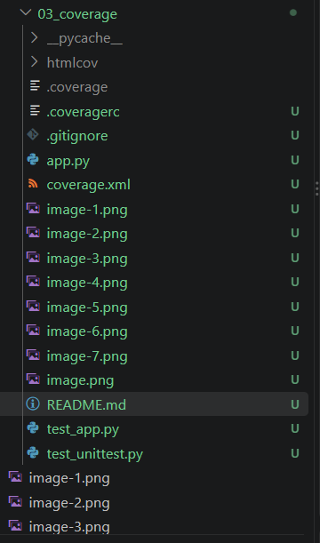
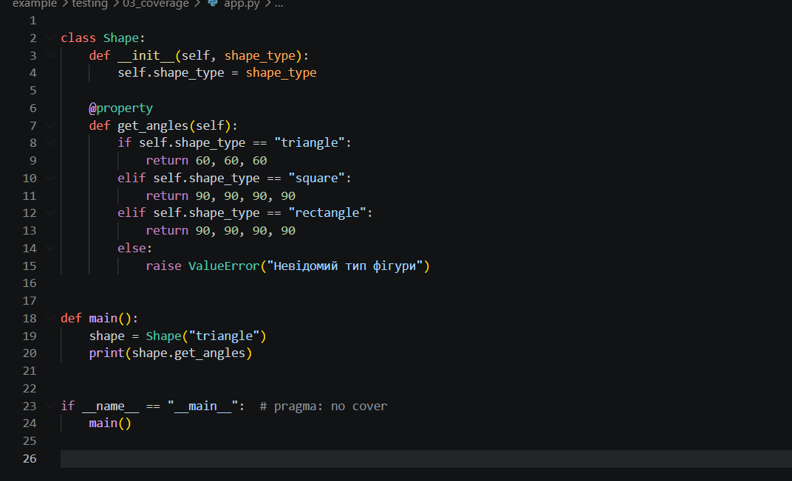
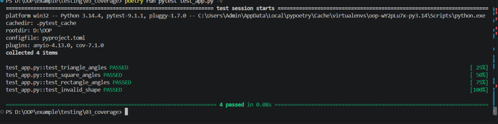
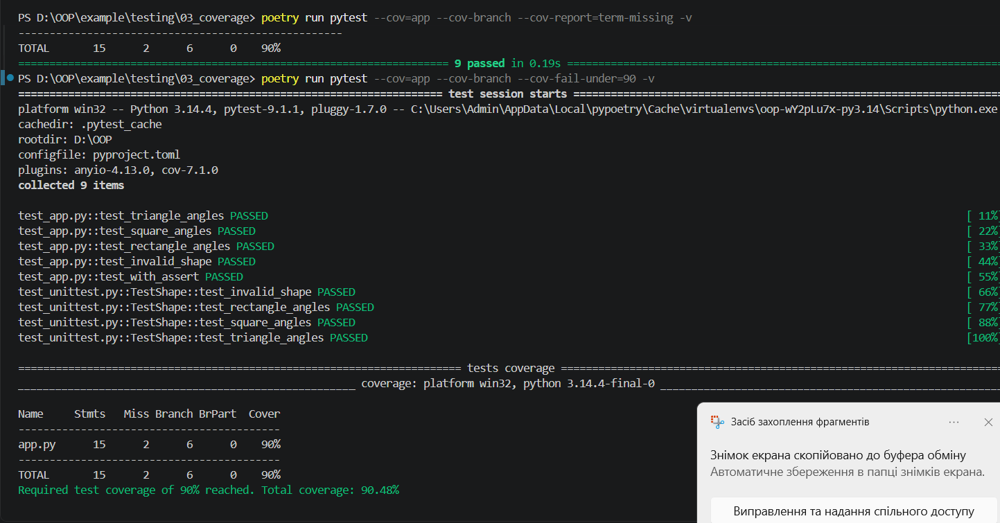
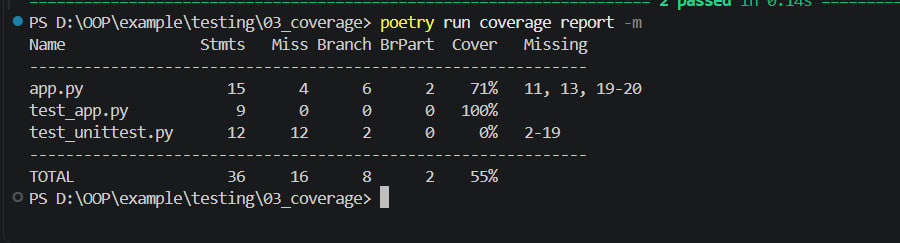
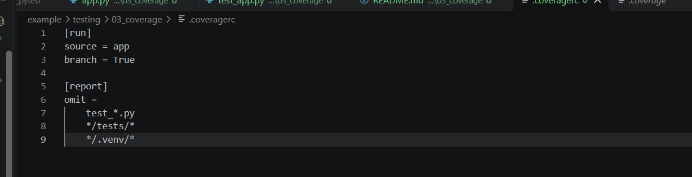
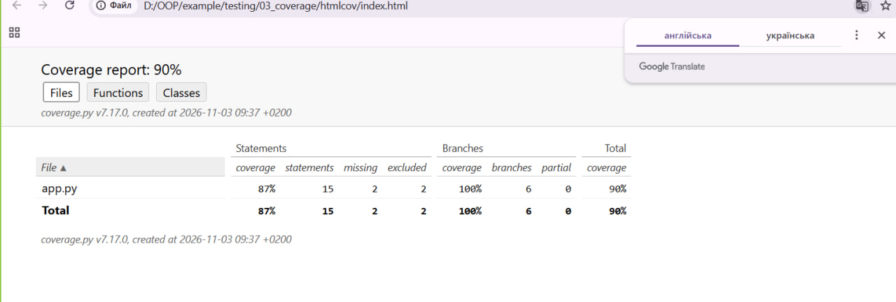
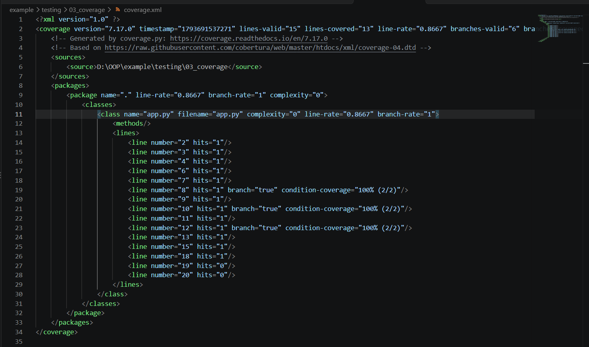
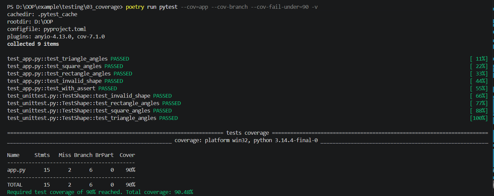
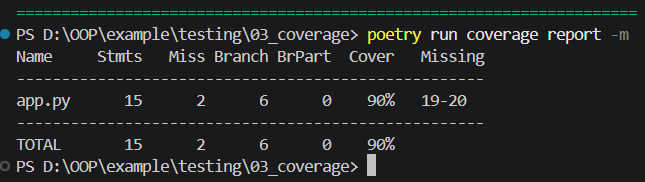

# Звіт до лабораторної роботи

**Тема:** Покриття коду тестами (Code Coverage)

**Мета роботи:** Ознайомитися з інструментами вимірювання покриття коду тестами в Python, навчитися аналізувати результати тестування, створювати звіти про покриття та налаштовувати мінімальний відсоток покриття.

**Виконала:** Половко Аліна, КН-42

## Завдання 1. Підготовка проєкту

Для виконання лабораторної роботи я перейшла до папки `03_coverage`, яка розташована в каталозі `D:\OOP\example\testing`. У цій папці містяться файл `app.py` із програмним кодом, файл `test_app.py` для тестування за допомогою pytest та файл `test_unittest.py` для тестування за допомогою unittest.

Для переходу до папки проєкту я використала команду:

```powershell
cd D:\OOP\example\testing\03_coverage
```

**Рисунок 1 — Структура проєкту**



## Завдання 2. Аналіз програмного коду

У файлі `app.py` реалізовано клас `Shape`, який використовується для роботи з геометричними фігурами. Властивість `get_angles` повертає кути залежно від типу фігури.

Для трикутника програма повертає три кути по 60 градусів, для квадрата та прямокутника — чотири кути по 90 градусів. Якщо передати невідомий тип фігури, програма викликає помилку `ValueError`.

Також у коді є конструкція `if __name__ == "__main__"`, яка позначена коментарем `# pragma: no cover`, щоб виключити відповідну ділянку з підрахунку покриття.

**Рисунок 2 — Програмний код файлу `app.py`**



## Завдання 3. Створення тестів

Для перевірки правильності роботи програми я створила тести за допомогою pytest та unittest. Тести перевіряють обчислення кутів трикутника, квадрата й прямокутника, а також обробку невідомого типу фігури.

Для запуску тестів pytest я використала команду:

```powershell
poetry run pytest test_app.py -v
```

Для запуску тестів unittest використала команду:

```powershell
poetry run python -m unittest discover -s . -p "test_unittest.py" -v
```

У результаті тести перевірили основні варіанти роботи програми та правильність обробки помилок.

**Рисунок 3 — Результат виконання тестів**



## Завдання 4. Вимірювання покриття коду

Для визначення відсотка покриття коду тестами я використала інструмент pytest-cov. Для цього виконала команду:

```powershell
poetry run pytest --cov=app --cov-branch -v
```

Ця команда запускає тести та показує, які частини програми були виконані під час тестування. Параметр `--cov-branch` додатково враховує покриття розгалужень.

На початковому етапі покриття становило приблизно 71%. Після додавання тестів для квадрата та прямокутника цей показник збільшився.

**Рисунок 4 — Початковий звіт про покриття коду**



## Завдання 5. Налаштування конфігурації покриття

Для налаштування вимірювання покриття я створила файл `.coveragerc` з такими параметрами:

```ini
[run]
source = app
branch = True

[report]
omit =
    test_*.py
    */tests/*
    */.venv/*
```

У конфігурації вказано, що потрібно перевіряти файл `app.py`. Також увімкнено перевірку розгалужень, а тестові файли та файли віртуального середовища виключено зі звіту.

Щоб не додавати до репозиторію тимчасові результати тестування, я створила файл `.gitignore`:

```gitignore
__pycache__/
.coverage
htmlcov/
.pytest_cache/
```

**Рисунок 5 — Файл конфігурації `.coveragerc`**



## Завдання 6. Створення HTML-звіту

Для створення HTML-звіту я виконала команду:

```powershell
poetry run coverage html
```

Після виконання команди у папці `htmlcov` сформувалися файли звіту, які дають змогу переглядати результати покриття в браузері.

Для відкриття звіту використала команду:

```powershell
start .\htmlcov\index.html
```

У звіті можна переглянути загальний відсоток покриття, кількість перевірених рядків і рядки, які не виконувалися під час тестування.

**Рисунок 6 — HTML-звіт про покриття коду**



## Завдання 7. Створення XML-звіту

Для формування звіту у форматі XML я виконала команду:

```powershell
poetry run coverage xml
```

У результаті було створено файл `coverage.xml`, який містить інформацію про покриття коду. Такий формат можна використовувати для автоматизованого аналізу результатів тестування.

Показник `line-rate` у XML-звіті відображає покриття рядків коду, тому він може відрізнятися від загального показника pytest-cov, який також враховує розгалуження.

**Рисунок 7 — Створення XML-звіту**



## Завдання 8. Перевірка мінімального порога покриття

Для перевірки відповідності покриття встановленій вимозі я виконала команду:

```powershell
poetry run pytest --cov=app --cov-branch --cov-fail-under=90 -v
```

Параметр `--cov-fail-under=90` встановлює мінімальний поріг покриття на рівні 90%. Якщо показник буде нижчим, команда завершиться з помилкою.

Після додавання тестів усі дев'ять тестів пройшли успішно. Загальний показник покриття становив 90,48%, тому встановлений поріг було досягнуто.

**Рисунок 8 — Успішне проходження тестів із порогом покриття 90%**



## Покриття 

90%- виконано успішно

## Висновок

Під час виконання лабораторної роботи я ознайомилася з вимірюванням покриття коду тестами в Python. Я створила тести для перевірки роботи класу `Shape`, використала pytest і unittest, а також навчилася визначати відсоток покриття програмного коду.

Крім цього, я налаштувала файл `.coveragerc`, створила HTML- та XML-звіти й встановила мінімальний поріг покриття на рівні 90%. У результаті всі дев'ять тестів пройшли успішно, а покриття коду становило 90,48%. Це допомогло мені закріпити навички тестування програм і перевірки якості коду.
